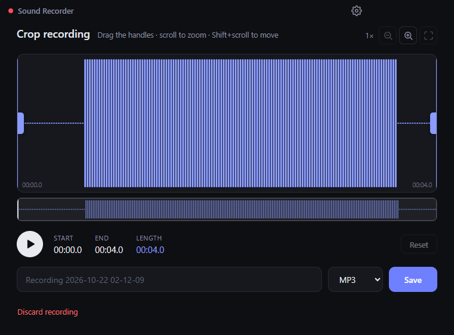

# Sound Recorder

A simple, dark-themed Windows desktop app that records **everything playing on your computer**, lets you crop the recording, and saves it as **MP3, MP4 or WAV**.

No extra drivers or virtual audio cables are needed. It uses Windows' built-in system audio capture (loopback).

<p align="center">
  
  
</p>

## Features

- **One-button recording** of system audio, with a live timer and level meter
- **Microphone toggle**: mute or unmute your mic at any time while recording. It's mixed into the same file.
- **Clean, lossless capture**: stereo, with no noise suppression, echo cancellation or auto gain
- **Crop editor**:
  - Waveform with draggable start and end handles
  - Play the selection to preview it (Space)
  - Zoom with the mouse wheel or the `+` `-` `0` keys, and pan with Shift+wheel
  - Overview strip of the whole recording
- **Save as**:
  - MP3 (320 kbps)
  - MP4 / AAC (256 kbps)
  - WAV (lossless)
- **Smart file names**:
  - Empty name → `Recording YYYY-MM-DD HH-MM-SS`
  - Duplicates get ` (1)`, ` (2)`…
  - Characters Windows doesn't allow are removed
- **Remembers your save folder**. It asks once, and you can change it later in Options.

## Install

Download `Sound Recorder Setup x.y.z.exe` from the [Releases](../../releases) page and run it.

> **Note:** The installer isn't code-signed yet, so Windows SmartScreen may show a warning. Click **More info → Run anyway**.

**Requirements:** Windows 10 or 11 (64-bit).

## Build from source

You need [Node.js](https://nodejs.org/) 20.19+ or 22.12+.

```bash
npm install
```

| Command | What it does |
| --- | --- |
| `npm run dev` | Run the app in development mode with hot reload |
| `npm start` | Build the UI and run the app |
| `npm run dist` | Build the Windows installer into `release/` |
| `npm run test:e2e` | End-to-end test of the installed app (see below) |

## How it works

```
Recorder.jsx ──► lib/recorder.js ──► Editor.jsx ──► lib/wav.js ──► preload.cjs ──► electron/main.cjs
 (UI)            captures system      crop &         cropped part   safe bridge      saves the file,
                 audio + mic          preview        → WAV                           FFmpeg → MP3 / MP4
```

- **Capture**: the main process answers the renderer's `getDisplayMedia()` request with Windows loopback audio. The video track is dropped. An `AudioWorklet` collects raw samples, so nothing is compressed while recording.
- **Mixing**: the microphone (optional) and system audio are mixed with the Web Audio API.
- **Encoding**: WAV is written directly. MP3 and MP4 are encoded by a bundled copy of FFmpeg ([`ffmpeg-static`](https://github.com/eugeneware/ffmpeg-static)).

### Project structure

```
electron/
  main.cjs          Window, audio capture permission, settings, saving, FFmpeg conversion
  preload.cjs       Safe bridge exposing save/settings functions to the UI (window.api)
src/
  App.jsx           Switches between recorder and editor; title bar + Options button
  components/       Recorder, Editor (crop), Settings, Icons
  lib/              recorder.js, pcm-worklet.js, peaks.js, wav.js, format.js
  styles.css        All styling (theme colors at the top)
tests/
  e2e-installed.mjs End-to-end test of the packaged app
build/icon.png      App / installer icon
```

Built with [Electron](https://www.electronjs.org/), [React](https://react.dev/) and [Vite](https://vite.dev/). The installer is built with [electron-builder](https://www.electron.build/).

## Testing

`tests/e2e-installed.mjs` launches the real packaged app and drives it over the Chrome DevTools Protocol. It:

1. Plays test tones through your speakers and records them
2. Crops one recording and saves MP3, MP4 and WAV files
3. Checks each file's format and duration, and that the tones were captured in stereo
4. Also covers duplicate names, discard, the mic toggle, the Options window and app exit

It uses its own temporary profile and output folder, so your settings and recordings aren't touched.

```bash
npm run test:e2e
```

Test a fresh build before installing it:

```bash
APP_DIR=release/win-unpacked node tests/e2e-installed.mjs
```

Check the "choose folder" prompt on first save:

```bash
SCENARIO=firstsave node tests/e2e-installed.mjs
```

> The test plays short beeps through your speakers while it runs.

## Known limitations

- **Windows only**: system audio capture relies on Windows loopback.
- **Memory**: long recordings are kept in memory as raw audio (about 23 MB per minute, about 1.4 GB per hour).
- **Unsigned installer**: SmartScreen warns on first run.

## License

This project's code is released under the [MIT License](LICENSE).

The installer also bundles **FFmpeg**, which keeps its own license, the [GPL v3](https://www.gnu.org/licenses/gpl-3.0.html) (the `ffmpeg-static` build). FFmpeg runs as a separate program and is not covered by the MIT license. If you share the installer, also provide FFmpeg's license and a link to its source code. Both are available at [ffmpeg.org](https://ffmpeg.org/download.html).
