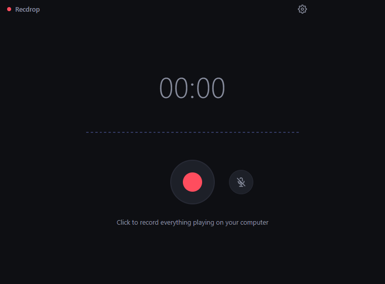
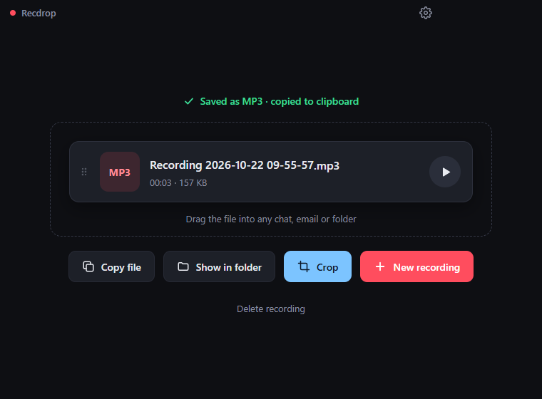
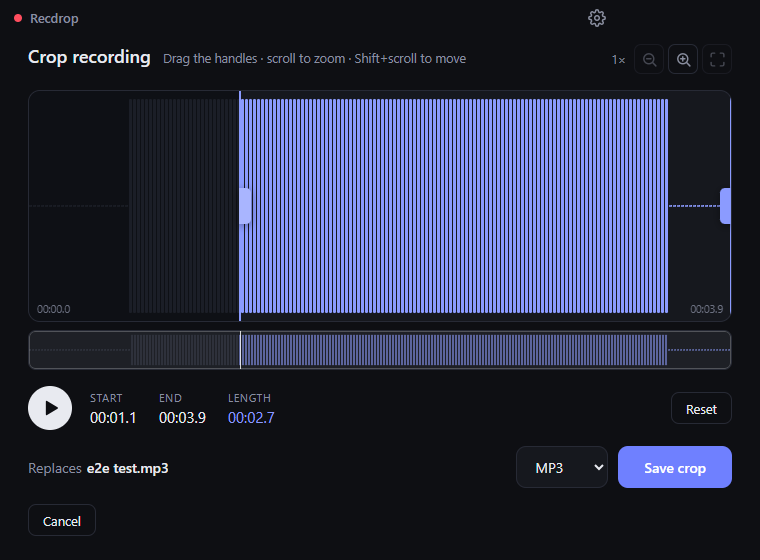

# Recdrop

**Record. Drop. Done.**

A simple, dark-themed Windows desktop app that records **everything playing on your computer**. Press stop and it's already saved as an **MP3** and copied to the clipboard, ready to drag or paste into any chat, email or folder. Cropping is optional and can also save as **MP4 or WAV**.

No extra drivers or virtual audio cables are needed. It uses Windows' built-in system audio capture (loopback).

<p align="center">
  
  
</p>
<p align="center">
  
</p>

## Features

- **One-button recording** of system audio, with a live timer and level meter
- **Microphone toggle**: mute or unmute your mic at any time while recording. It's mixed into the same file.
- **Clean, lossless capture**: stereo, with no noise suppression, echo cancellation or auto gain
- **Saved instantly**: when you stop, the recording is saved as an MP3 and **copied to the clipboard**, so you can paste it straight into a chat, an email or a folder.
- **Saved screen**:
  - **Drag the file** from the app into any chat, email or folder
  - **Rename it in place**: click the name and type. The file itself is renamed, with no copy made.
  - Play it, copy it again, show it in its folder, or delete it (moves to the Recycle Bin)
- **Crop (optional)**: replaces the saved file with the cropped version. It always uses the original lossless audio, so you can crop again or undo a crop without losing quality.
  - Waveform with draggable start and end handles
  - Play the selection to preview it (Space)
  - Zoom with the mouse wheel or the `+` `-` `0` keys, and pan with Shift+wheel
  - Overview strip of the whole recording
- **Save as**:
  - MP3 (320 kbps)
  - MP4 / AAC (256 kbps)
  - WAV (lossless)
- **Smart file names**:
  - New recordings are named `Recording YYYY-MM-DD HH-MM-SS`
  - Duplicates get ` (1)`, ` (2)`…
  - Characters Windows doesn't allow are removed
- **Save folder**: `Music\Recdrop` by default. You can change it in Options (gear icon).

## Install

Download `Recdrop Setup x.y.z.exe` from the [Releases](../../releases) page and run it.

> **Note:** The installer isn't code-signed yet, so Windows SmartScreen may show a warning. Click **More info → Run anyway**.

**Requirements:** Windows 10 or 11 (64-bit).

## Build from source

You need [Node.js](https://nodejs.org/) 20.19+ or 22.12+.

```bash
npm install
```

| Command | What it does |
| --- | --- |
| `npm run dev` | Run the app in development mode with hot reload |
| `npm start` | Build the UI and run the app |
| `npm run dist` | Build the Windows installer into `release/` |
| `npm run test:e2e` | End-to-end test of the installed app (see below) |

## How it works

```
Recorder.jsx ──► lib/recorder.js ──► App.jsx ──► lib/wav.js ──► preload.cjs ──► electron/main.cjs
 (UI)            captures system      auto-save    audio → WAV    safe bridge      saves the file,
                 audio + mic                                                       FFmpeg → MP3 / MP4
                                         │
                                         ▼
                                     Saved.jsx  ── Crop ──►  Editor.jsx  (replaces the file)
                              rename · drag · copy · delete
```

- **Capture**: the main process answers the renderer's `getDisplayMedia()` request with Windows loopback audio. The video track is dropped. An `AudioWorklet` collects raw samples, so nothing is compressed while recording.
- **Mixing**: the microphone (optional) and system audio are mixed with the Web Audio API.
- **Encoding**: WAV is written directly. MP3 and MP4 are encoded by a bundled copy of FFmpeg ([`ffmpeg-static`](https://github.com/eugeneware/ffmpeg-static)). Files are written to a temporary file first and then moved into place, so a failed save never destroys the existing file.
- **Clipboard, drag and delete**: the file is put on the clipboard as a file (like Ctrl+C in Explorer), dragged out with Electron's `startDrag`, and deleted with `shell.trashItem` (Recycle Bin).

### Project structure

```
electron/
  main.cjs          Window, audio capture permission, settings, saving, FFmpeg conversion
  preload.cjs       Safe bridge exposing file/settings functions to the UI (window.api)
  drag-icon.png     Icon shown while dragging a file out of the app
src/
  App.jsx           Switches between recorder and editor; title bar + Options button
  components/       Recorder, Saved (file card + actions), Editor (crop), Settings, Icons
  lib/              recorder.js, pcm-worklet.js, peaks.js, wav.js, format.js
  styles.css        All styling (theme colors at the top)
tests/
  e2e-installed.mjs End-to-end test of the packaged app
build/icon.png      App / installer icon
```

Built with [Electron](https://www.electronjs.org/), [React](https://react.dev/) and [Vite](https://vite.dev/). The installer is built with [electron-builder](https://www.electron.build/).

## Testing

`tests/e2e-installed.mjs` launches the real app and drives it over the Chrome DevTools Protocol. It:

1. Plays test tones through your speakers and records them
2. Checks the automatic MP3 save, the clipboard, and the file's format, length and stereo tones
3. Renames the file, including a name that's taken, invalid characters and Escape to cancel
4. Crops it, which must replace the file, then un-crops it and switches it to WAV
5. Also covers Copy file, dragging, delete to the Recycle Bin, New recording and the Options window

It uses its own temporary profile and output folder, so your settings and recordings aren't touched.

```bash
npm run test:e2e
```

Test a fresh build before installing it:

```bash
APP_DIR=release/win-unpacked node tests/e2e-installed.mjs
```

Test the project directly (run `npm run build` first):

```bash
APP_DIR=dev node tests/e2e-installed.mjs
```

Extra scenarios: `SCENARIO=defaultfolder` checks that the first recording goes to `Music\Recdrop`. `SCENARIO=savefail` checks that the editor opens if the save folder is unusable, so the recording isn't lost.

> The test plays short beeps through your speakers and uses your clipboard while it runs.

## Known limitations

- **Windows only**: system audio capture relies on Windows loopback.
- **Memory**: long recordings are kept in memory as raw audio (about 23 MB per minute, about 1.4 GB per hour).
- **Unsigned installer**: SmartScreen warns on first run.

## License

This project's code is released under the [MIT License](LICENSE).

The installer also bundles **FFmpeg**, which keeps its own license, the [GPL v3](https://www.gnu.org/licenses/gpl-3.0.html) (the `ffmpeg-static` build). FFmpeg runs as a separate program and is not covered by the MIT license. If you share the installer, also provide FFmpeg's license and a link to its source code. Both are available at [ffmpeg.org](https://ffmpeg.org/download.html).
